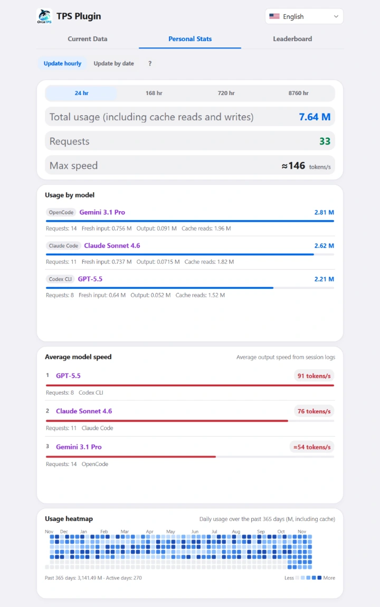

# TPS Plugin

**English** · **[简体中文](./README.zh-CN.md)** · **[Orca plugin directory](https://api.onorca.dev/plugins/jecyxyf/orca-tps-plugin)**

[](https://github.com/stablyai/orca)
[](https://github.com/jecyxyf/Orca-TPS-Plugin/actions/workflows/ci.yml)
[](./LICENSE)

## 1. Project description

TPS Plugin brings token usage and generation speed to the Orca sidebar. See what the current session is doing, review your usage over time, or join the leaderboard with a GitHub account.

The plugin supports local and SSH workspaces and remembers your choice of 15 interface languages. Conversation logs are read in place. The leaderboard receives usage totals.

## 2. Interface overview

Open **TPS Plugin** in Orca’s right sidebar to switch between **Current Data**, **Personal Stats**, and **Leaderboard**.

<p align="center">
  <a href="./assets/readme/en/overview.png" title="View full-size screenshot">
    
  </a>
</p>

*The screenshots use sample data.*

## 3. Features

### 3.1 Current Data

- Follow the active Orca channel and view up to 100 recent requests.
- See the model, output in Tokens, generation speed in tokens per second, request duration, time to first token (TTFT) when available, and cache hit rate.
- Check the latest speed and cache hit rate in the Orca status bar. Estimated speeds are marked with ≈.

<p align="center">
  <a href="./assets/readme/en/current-data.png" title="View full-size screenshot">
    
  </a>
</p>

### 3.2 Personal Stats

- Review usage and request counts for today, the last 7 or 30 days, or the past year. Today's summary also shows the highest generation speed for a single request.
- Break down usage by tool and model, and compare average model generation speeds. Usage is shown in millions of tokens (M) and includes new input, output, cache reads, and cache writes.
- See daily activity over the past 365 days in the heatmap. Request statistics, panel snapshots, and pending uploads are stored in a local SQLite database. The plugin keeps a year of personal usage and fills in older days from local logs that are still available.
- The original CC Switch 4.0.25 engine scans and summarizes usage for its supported local sources. Personal Stats uses the last successful result while it refreshes.

<p align="center">
  <a href="./assets/readme/en/personal-stats.png" title="View full-size screenshot">
    
  </a>
</p>

### 3.3 Leaderboard

- Browse usage rankings for the last 24 hours, 7 days, and 30 days in M. All four boards refresh together at the top of the hour. Usage counts the completed hours before that cutoff. The top three get gold, silver, and bronze medals.
- Use the switch next to Rankings to control leaderboard viewing. Turning it off hides the rankings and stops fetching them. The plugin remembers your choice. Guests can view rankings.
- The 24-hour usage tab shows the five-minute waveform and average generation speed before the cutoff. The 7-day and 30-day tabs show one usage point per 24-hour period. All three show the most-used model, Harness, and latest upload time.
- The Speed tab ranks up to 20 GitHub accounts by their best average generation speed from a qualifying upload in the past 24 hours. Each account appears once across all its devices. An upload qualifies with more than 500 new tokens and a valid speed. The winning upload supplies the time, most-used model, Harness, and full count of new tokens, such as `1,250,000 tokens`.
- Each curve uses a continuous gradient from green at zero to red at the highest point. The fill uses the same gradient at 50% opacity.
- Sign in with GitHub to participate. The leaderboard adds each computer's local usage and counts each SSH account once, even when several computers connect to it. The plugin fetches avatars directly from GitHub and shows a built-in black hat avatar until one loads. Missing avatars are retried after the next sync, and a loaded avatar is reused everywhere it appears.
- While signed in, the plugin attempts to upload every 10 seconds. Manual uploads use the same interval. Each toolbar has a manual button on the left, with an hourglass countdown and a clock for the last successful upload or sync on the right. Upload failures appear below the account toolbar.

<p align="center">
  <a href="./assets/readme/en/leaderboard.png" title="View full-size screenshot">
    
  </a>
</p>

## 4. Supported Harnesses

**Personal Stats on this machine** uses CC Switch 4.0.25 for Claude Code, Codex, Gemini CLI, OpenCode, Grok Build, Pi, Oh My Pi, MiniMax Code, Kimi Code, Antigravity CLI, and DeepSeek Harness. Claude Desktop requests recorded through CC Switch's local model routing count under Claude Code.

**Orca session collection** supports these harnesses:

- Codex CLI
- Claude Code (including subagents)
- OpenCode v1 and v2
- Pi Agent
- Antigravity CLI
- Hermes Agent

## 5. Installation

Use **Orca 1.4.251 or later** on Windows or Linux. To collect usage from an SSH workspace, the remote host needs **Node.js 22.13 or later with SQLite support**.

The CC Switch usage helper is bundled for Windows x64. To build it on another platform, install Rust stable and the [CC Switch platform build prerequisites](https://github.com/farion1231/cc-switch/blob/v4.0.25/CONTRIBUTING.md), then run `npm run build:cc-switch-usage` in the plugin directory.

### Orca plugin directory

Open **Settings → Plugins**, search for **TPS**, and select the entry by **jecyxyf**. Click **Install** and review the requested permissions. Orca downloads the plugin for you. [View the plugin listing](https://api.onorca.dev/plugins/jecyxyf/orca-tps-plugin)

### Local installation

Clone this repository.

```sh
git clone https://github.com/jecyxyf/Orca-TPS-Plugin.git
```

In Orca, open **Settings → Plugins → Development folders…** and add the cloned folder containing `orca-plugin.json`. Review the permissions and enable the plugin. Keep the cloned folder in place while using it.

After installation, open **TPS Plugin** in Orca’s right sidebar.

[MIT License](./LICENSE) · [Third-party notices](./THIRD_PARTY_NOTICES.md) · [Leaderboard server guide](./server/README.md)
