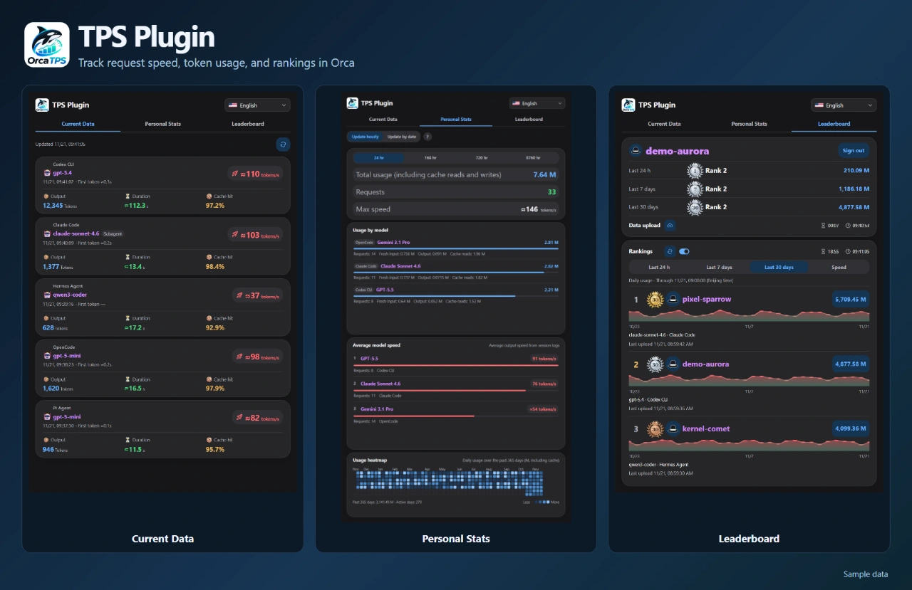
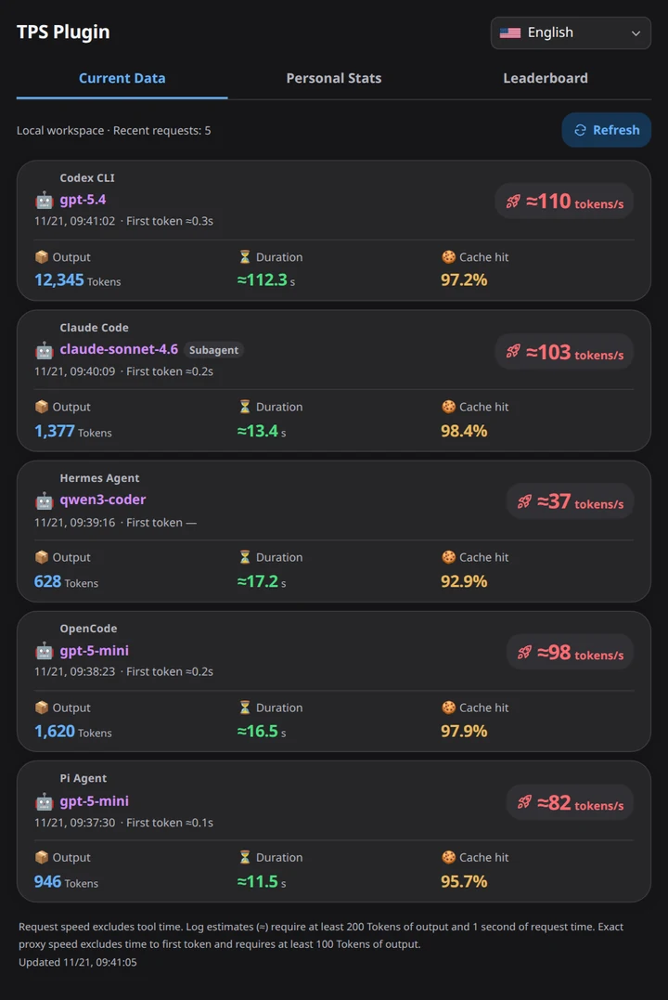
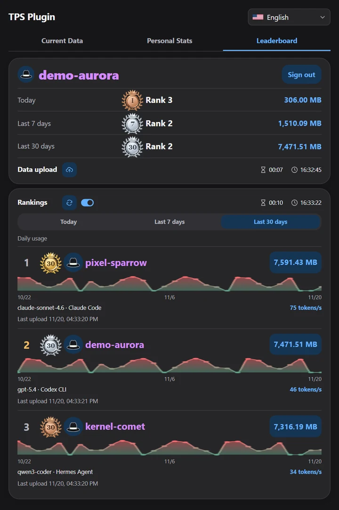

# TPS Plugin

**English** · **[简体中文](./README.zh-CN.md)** · **[Orca plugin directory](https://api.onorca.dev/plugins/jecyxyf/orca-tps-plugin)**

[](https://github.com/stablyai/orca)
[](https://github.com/jecyxyf/Orca-TPS-Plugin/actions/workflows/ci.yml)
[](./LICENSE)

## 1. Project description

TPS Plugin brings token usage and generation speed to the Orca sidebar. See what the current session is doing, review your usage over time, or join the leaderboard with a GitHub account.

The plugin supports local and SSH workspaces and remembers your choice of 10 interface languages. Conversation logs are read in place. The leaderboard receives usage totals.

## 2. Interface overview

Open **TPS Plugin** in Orca’s right sidebar to switch between **Current Data**, **Personal Stats**, and **Leaderboard**.

<p align="center">
  <a href="./assets/readme/en/overview.png" title="View full-size screenshot">
    
  </a>
</p>

*The screenshots use sample data.*

## 3. Features

### 3.1 Current Data

- Follow the active Orca channel and view up to 100 recent requests.
- See the model, output in KB, generation speed in tokens per second, request duration, time to first token (TTFT) when available, and cache hit rate.
- Check the latest speed and cache hit rate in the Orca status bar. Estimated speeds are marked with ≈.

<p align="center">
  <a href="./assets/readme/en/current-data.png" title="View full-size screenshot">
    
  </a>
</p>

### 3.2 Personal Stats

- Review usage and request counts for today, the last 7 days, or the last 30 days.
- Break down usage by tool and model, and compare average model generation speeds. Usage in MB includes new input, output, cache reads, and cache writes.
- Use the annual heatmap to see daily activity over the past year.
- Usage history is cached locally and restored when Orca restarts.

<p align="center">
  <a href="./assets/readme/en/personal-stats.png" title="View full-size screenshot">
    
  </a>
</p>

### 3.3 Leaderboard

- Browse today’s, 7-day, and 30-day rankings. Entries show GitHub avatars, and the top three get gold, silver, and bronze medals.
- Use the switch next to Rankings to control leaderboard viewing. Turning it off hides the rankings and stops fetching them. The plugin remembers your choice. Guests can view rankings.
- The top 100 entries show a five-minute waveform with one peak per upload on Today. The 7-day and 30-day curves pass through every Beijing calendar day's usage, with zero on days without records. Entries also show the latest average generation speed, most-used model and CLI, and last upload time. The leaderboard refreshes every 10 seconds while enabled and open.
- Each curve uses a continuous gradient from green at zero to red at the highest point. The fill uses the same gradient at 50% opacity.
- Sign in with GitHub to participate. The leaderboard combines usage across installations linked to the same account. The plugin fetches avatars directly from GitHub and shows a built-in black hat avatar until one loads. Missing avatars are retried after the next sync, and a loaded avatar is reused everywhere it appears.
- While signed in, the plugin attempts to upload every 10 seconds. Manual uploads use the same interval. Each toolbar has a manual button on the left, with an hourglass countdown and a clock for the last successful upload or sync on the right. Upload failures appear below the account toolbar.

<p align="center">
  <a href="./assets/readme/en/leaderboard.png" title="View full-size screenshot">
    
  </a>
</p>

## 4. Supported Harnesses

- Codex CLI
- Claude Code (including subagents)
- OpenCode v1 and v2
- Pi Agent
- Antigravity CLI
- Hermes Agent

## 5. Installation

Use **Orca 1.4.251 or later** on Windows or Linux. To collect usage from an SSH workspace, the remote host needs **Node.js 22.13 or later with SQLite support**.

### Orca plugin directory

Open **Settings → Plugins**, search for **TPS**, and select the entry by **jecyxyf**. Click **Install** and review the requested permissions. Orca downloads the plugin for you. [View the plugin listing](https://api.onorca.dev/plugins/jecyxyf/orca-tps-plugin)

### Local installation

Clone this repository.

```sh
git clone https://github.com/jecyxyf/Orca-TPS-Plugin.git
```

In Orca, open **Settings → Plugins → Development folders…** and add the cloned folder containing `orca-plugin.json`. Review the permissions and enable the plugin. Keep the cloned folder in place while using it.

After installation, open **TPS Plugin** in Orca’s right sidebar.

[MIT License](./LICENSE) · [Third-party notices](./THIRD_PARTY_NOTICES.md) · [Leaderboard server guide](./server/README.md)
