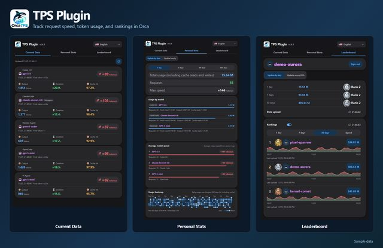

# TPS Plugin

**English** · **[简体中文](./README.zh-CN.md)** · **[Orca plugin directory](https://api.onorca.dev/plugins/jecyxyf/orca-tps-plugin)**

## 1. Project description

TPS Plugin shows AI request token usage and generation speed in the Orca sidebar. Inspect the current session, review your usage over time, or join the leaderboard with a GitHub account.

The plugin supports local and remote workspaces, offers 15 interface languages, and remembers your selection.

## 2. Interface overview

Open **TPS Plugin** in Orca’s right sidebar to switch between **Current Data**, **Personal Stats**, and **Leaderboard**.

  

*The screenshots use sample data.*

## 3. Features

### 3.1 Current Data

- Follow the active Orca channel and view up to 100 recent requests.
- See the model, output in Tokens, generation speed in tokens per second, request duration, time to first token (TTFT) when available, and cache hit rate.
- Check the latest speed and cache hit rate in the Orca status bar. Estimated speeds are marked with ≈.

  

### 3.2 Personal Stats

- Review usage and requests for today, the last 7 or 30 days, this calendar year, or the past 365 days. Today's summary also shows the highest generation speed for a single request.
- Break down usage by tool and model, and compare average model generation speeds. Usage is shown in millions of tokens (M) and includes new input, output, cache reads, and cache writes.
- Personal Stats combines local and SSH usage without signing in. The heatmap covers the past 365 days. Set the statistics time zone in the TPS Plugin settings in Orca.

  

### 3.3 Leaderboard

- View token usage rankings and trends by day or hour.
- Compare each account’s best average generation speed and see the model and Harness used for that result.
- Turn on Rankings to get automatic updates. Sign in with GitHub to participate. Usage from multiple devices is combined under the same account.

  

## 4. Supported Harnesses

  

## 5. How it works

  

- Each local or remote device collects and stores its own token usage.
- Tokens Managers sync usage over SSH. Personal Stats and leaderboard submissions use the same totals.
- The leaderboard server calculates rankings in memory and keeps usage and speed data in memory only. [Server guide](./server/README.md)
- The leaderboard server runs without a database. Raw session logs stay on your devices, and GitHub account and sign-in data are stored in a file on the server.

## 6. Installation

> [!IMPORTANT]
> **Upgrading from 1.6.4**
>
> Version 1.6.5 substantially changes the plugin structure and moves the leaderboard to a new server. Uninstall the old TPS Plugin in Orca, then install **1.6.6**.

- **Requirements.** Use Orca 1.4.251 or later on Windows or Linux. For SSH workspace usage, the remote host needs Node.js 22.13 or later with SQLite support.
- **Install from the plugin directory.** In Orca, open **Settings → Plugins**, search for **TPS** by **jecyxyf**, then install it and review the permissions. [View the plugin listing](https://api.onorca.dev/plugins/jecyxyf/orca-tps-plugin)
- **Install locally.** Clone this repository. In **Settings → Plugins → Development folders…**, add the folder containing `orca-plugin.json` and enable the plugin.
- **Open the plugin.** Select **TPS Plugin** in Orca’s right sidebar.

## 7. Known issues

If a device submits to the leaderboard and shuts down before syncing, Personal Stats on other devices can lag behind. Stats catch up once the device reconnects and syncs. Future versions will keep the current sync approach.

## 8. Next version

Overhaul the plugin’s visual design and layout to make it feel more modern and fun.

[MIT License](./LICENSE) · [Third-party notices](./THIRD_PARTY_NOTICES.md)
