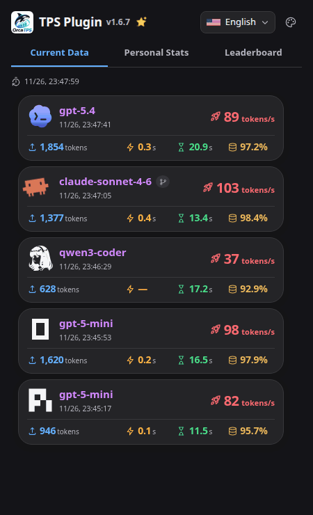
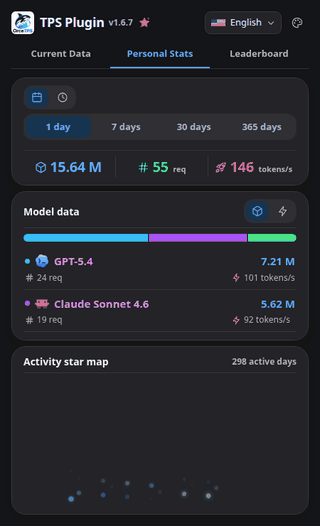
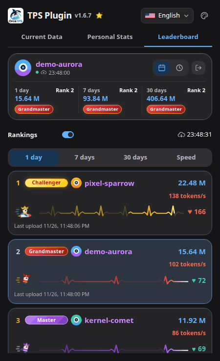
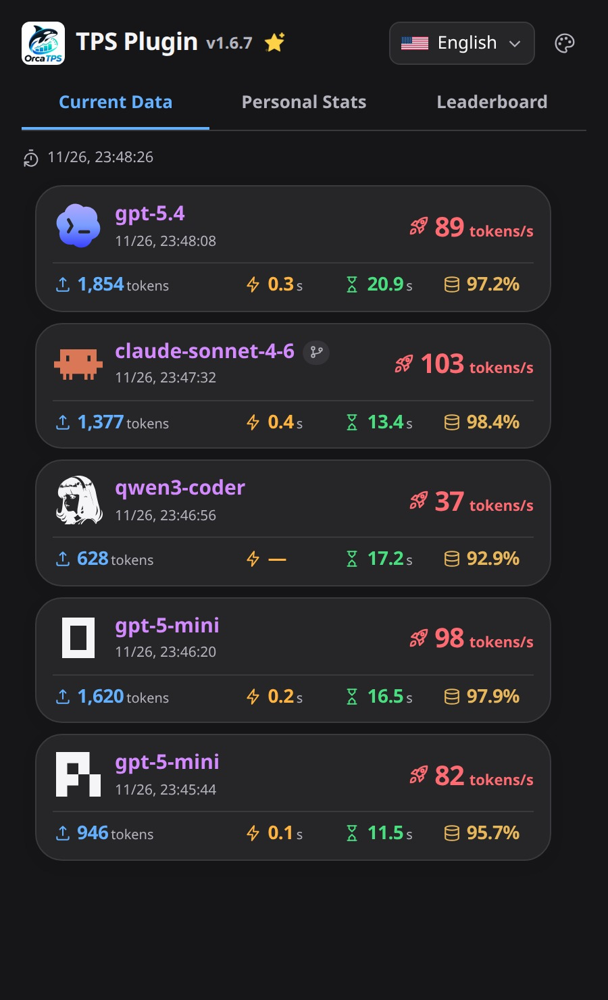
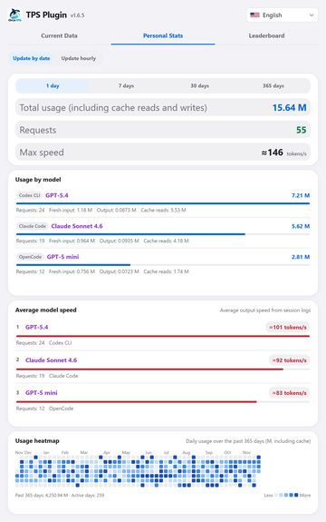
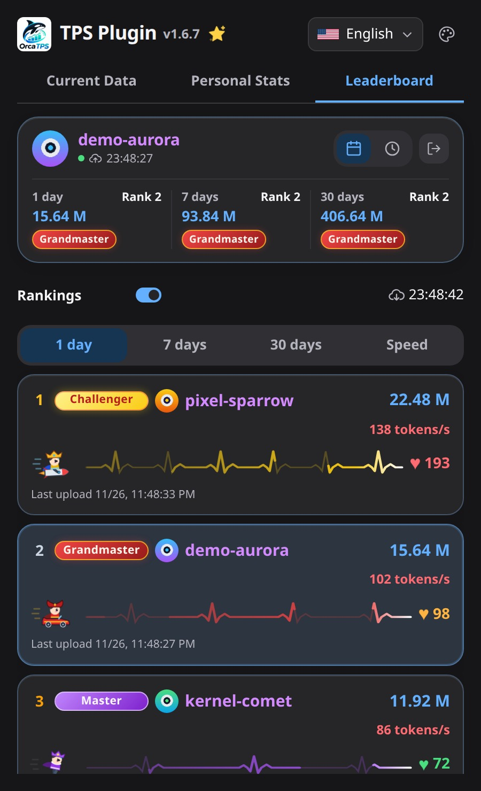
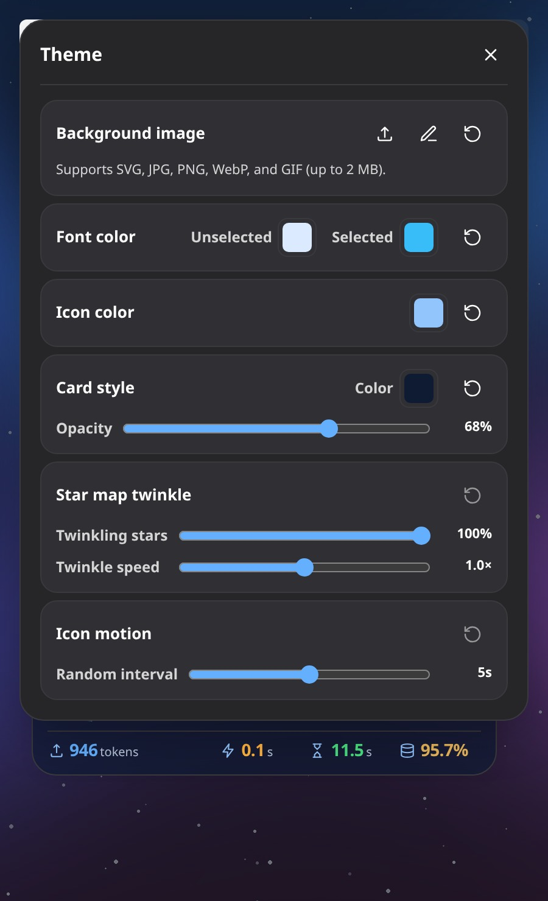
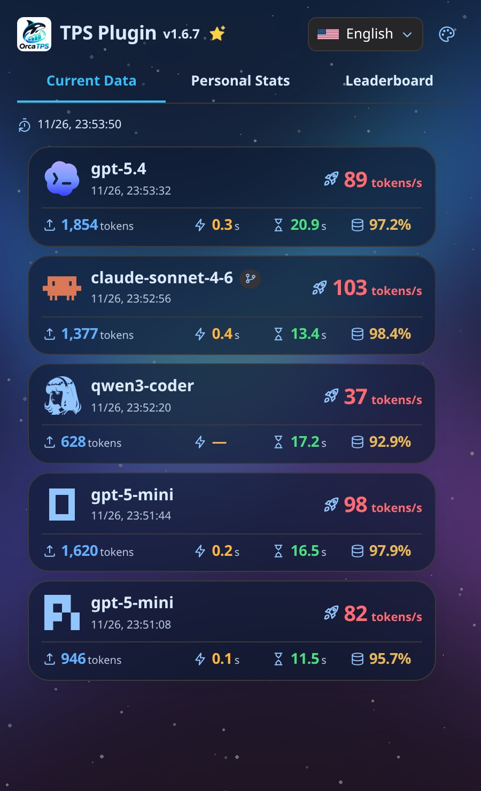

# TPS Plugin

**English** · **[简体中文](./README.zh-CN.md)** · **[Orca plugin directory](https://api.onorca.dev/plugins/jecyxyf/orca-tps-plugin)**

> [!NOTE]
> **Before you start**
>
> Just a fun side-project plugin — spaghetti code, if it works, it works.
>
> - **Background collection**: To aggregate token usage across all your devices and keep server load low, a Token Manager script runs in the background on each device. Please skip this plugin if that bothers you.
> - **In-memory only**: The leaderboard server has no database, runs purely in memory, and stores no user data.
> - **Directory listing**: For reasons unknown, this version still hasn’t been picked up by the official plugin directory yet.
> - **Roadmap**: Maintenance fixes only from here on — no new features until **1,000 stars**.
>
> Hope this plugin brings a bit of joy to your coding journey.

## 1. Project description

TPS Plugin shows AI request token usage and generation speed in the Orca sidebar. Inspect the current session, track personal usage with interactive charts and a 365-day star map, customize the panel theme, or join the live leaderboard with a GitHub account.

The plugin supports local and remote workspaces, offers 17 interface languages, and remembers your selection.

## 2. Interface overview

Open **TPS Plugin** in Orca’s right sidebar to switch between **Current Data**, **Personal Stats**, and **Leaderboard**.

<table>
  <tr>
    <td width="33%" align="center">
       
      <b>Current Data</b>
    </td>
    <td width="33%" align="center">
       
      <b>Personal Stats</b>
    </td>
    <td width="33%" align="center">
       
      <b>Leaderboard</b>
    </td>
  </tr>
</table>

*The previews use sample data.*

## 3. Features

### 3.1 Current Data

- Follow the active Orca channel and view up to 100 recent requests with Harness icons, proxy/subagent badges, and live update timestamps.
- See the model, output in Tokens, generation speed in tokens per second, request duration, time to first token (TTFT) when available, and cache hit rate.
- New incoming requests trigger an aurora border sweep and rainbow stardust burst, while visible Harness icons perform periodic idle animations.
- Check the latest speed and cache hit rate in the Orca status bar (estimated speeds are marked with `≈`), and open or star the GitHub repository right from the header.

  

### 3.2 Personal Stats

- Switch between **By Day** and **By Hour** modes with the top icon capsule, and review usage across **1 day**, **7 days**, **30 days**, and **365 days**.
- View total usage (including cache reads and writes), request count, and today’s max single-request speed; incoming usage animates with count-up numbers, row flashes, and `+Δ` badges.
- Inspect **Model data** with a segmented share bar at the top and toggle between sorting by **Usage** or **Speed**, showing each model’s Harness icon, tokens, request count, and average speed.
- Explore the 365-day **Activity star map** with a drop-in entrance animation and twinkling stars. Combines local and SSH usage automatically without signing in.

  

### 3.3 Leaderboard

- View your signed-in account, sync status, and **1 day / 7 days / 30 days** rankings in one summary card with 7 royal tier badges (Challenger, Grandmaster, Master, Diamond, Emerald, Platinum, Gold).
- **1 day** calculates live activity BPM from uploads in the last 5 minutes, pairing animated royal characters (rocket, sports car, sprinting, panting, flatline) with tier-colored live ECG heartbeat waves.
- **7 days** draws tier-colored glowing curves with a light sweep and pulsing tip; **30 days** displays a tier-colored animated dot-matrix equalizer.
- **Speed** compares each account’s best average generation speed, marks the top three with `S` tier badges, and shows the model, Harness icon, and token count.

  

### 3.4 Theme Customization

Click the palette button in the top-right header to open the live **Theme** panel without dimming the background:

- **Background image**: Upload SVG, JPG, PNG, WebP, or GIF images (up to 2 MB) and adjust them in a full-panel editor (drag to pan, scroll or click to zoom, and reset position).
- **Font & icon colors**: Customize unselected text, selected accent, and icon colors independently, with one-click reset.
- **Card style**: Pick a custom card color and adjust opacity from `0%` to `100%` to achieve a frosted-glass backdrop over custom backgrounds.
- **Star map twinkle**: Fine-tune the percentage of twinkling stars (`0%`–`100%`) and twinkle speed (`0×`–`2.0×`).
- **Icon motion**: Adjust the random trigger interval (`0s`–`10s`) for Harness icon animations on the Current Data tab.

<table>
  <tr>
    <td width="50%" align="center">
       
      <b>Theme settings panel</b>
    </td>
    <td width="50%" align="center">
       
      <b>Custom background &amp; translucent cards</b>
    </td>
  </tr>
</table>

## 4. Supported Harnesses

  

## 5. How it works

  

- Each local or remote device collects and stores its own token usage.
- Tokens Managers sync usage over SSH. Personal Stats and leaderboard submissions use the same totals.
- The leaderboard server calculates rankings in memory and keeps usage and speed data in memory only. [Server guide](./server/README.md)
- The leaderboard server runs without a database. Raw session logs stay on your devices, and GitHub account and sign-in data are stored in a file on the server.

## 6. Installation

> [!IMPORTANT]
> **Upgrading from 1.6.4**
>
> Version 1.6.5+ substantially changes the plugin structure and moves the leaderboard to a new server. Uninstall the old TPS Plugin in Orca, then install **1.6.8**.

- **Requirements.** Use Orca 1.4.251 or later on Windows or Linux. For SSH workspace usage, the remote host needs Node.js 22.15 or later with SQLite support.
- **Install from the plugin directory.** In Orca, open **Settings → Plugins**, search for **TPS** by **jecyxyf**, then install it and review the permissions. [View the plugin listing](https://api.onorca.dev/plugins/jecyxyf/orca-tps-plugin)
- **Install locally.** Clone this repository. In **Settings → Plugins → Development folders…**, add the folder containing `orca-plugin.json` and enable the plugin.
- **Open the plugin.** Select **TPS Plugin** in Orca’s right sidebar.

[MIT License](./LICENSE) · [Third-party notices](./THIRD_PARTY_NOTICES.md)
