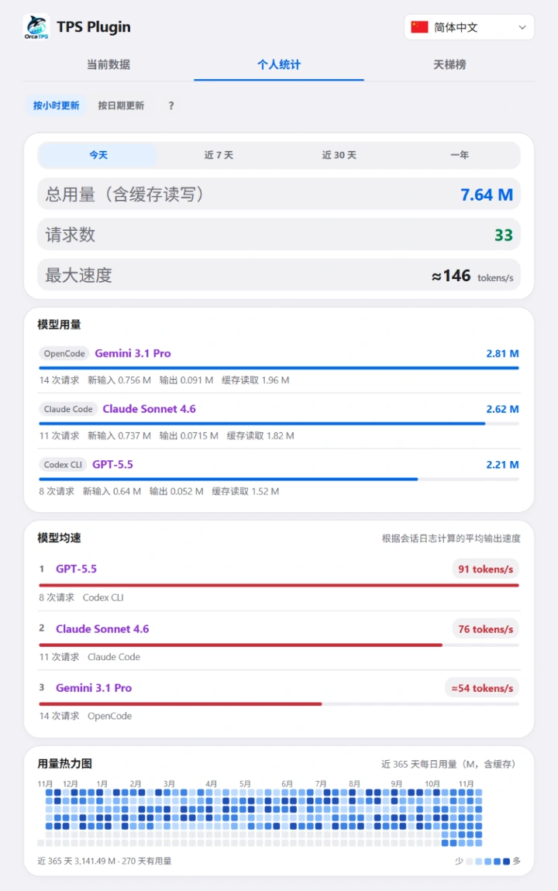

# TPS Plugin

**[English](./README.md)** · **简体中文** · **[Orca 插件目录](https://api.onorca.dev/plugins/jecyxyf/orca-tps-plugin)**

[](https://github.com/stablyai/orca)
[](https://github.com/jecyxyf/Orca-TPS-Plugin/actions/workflows/ci.yml)
[](./LICENSE)

## 1. 项目描述

TPS Plugin 是一款 Orca 插件，让你在侧栏查看 Token 用量和生成速度。你可以查看当前会话的请求、回顾个人用量，也可以用 GitHub 账号参加天梯榜。

插件支持本地和 SSH 工作区，可切换 15 种界面语言，并记住上次选择。会话日志在原处读取，天梯榜接收的是用量汇总。

## 2. 界面预览

在 Orca 右侧栏打开 **TPS Plugin**，即可切换**当前数据**、**个人统计**和**天梯榜**。

<p align="center">
  <a href="./assets/readme/zh-CN/overview.png" title="查看原图">
    
  </a>
</p>

*截图使用示例数据。*

## 3. 功能描述

### 3.1 当前数据

- 跟随当前 Orca 频道，最多显示最近 100 次请求。
- 查看模型、输出量（KB）、生成速度（tokens/s）、请求耗时和缓存命中率。有记录时也会显示首字延迟。
- Orca 底部状态栏显示最新速度和缓存命中率。估算速度带有 ≈ 标记。

<p align="center">
  <a href="./assets/readme/zh-CN/current-data.png" title="查看原图">
    
  </a>
</p>

### 3.2 个人统计

- 查看今日、近 7 天和近 30 天的用量与请求数。
- 按工具和模型查看用量，比较各模型的平均生成速度。用量以 MB 显示，包含新输入、输出和缓存读写。
- 用年度热力图查看过去一年每天的用量。
- 用量历史会缓存在本地，重启 Orca 后可恢复。

<p align="center">
  <a href="./assets/readme/zh-CN/personal-stats.png" title="查看原图">
    
  </a>
</p>

### 3.3 天梯榜

- 查看近 24 小时、近 7 天和近 30 天用量排名。每个整点统计过去 24、168、720 个完整小时，前三名分别有金、银、铜奖牌。
- 天梯排名旁的开关控制榜单的显示和拉取，并记住上次选择。关闭时收起榜单和个人名次。未登录也可以查看榜单。
- 近 24 小时榜显示最近 5 分钟的用量波形和平均速度。近 7 天和近 30 天的曲线每 24 小时取一个用量点。三个周期都显示最常用模型、Harness 和上次上传时间。启用榜单后，查看时每 10 秒更新近期数据。
- 速度榜取过去 24 小时速度最快的 100 笔上传。本次新增用量超过 500 Token 且速度有效才可入榜，每笔显示用户、时间、平均速度、最常用模型和 Harness。
- 曲线从零线的绿色连续过渡到最高点的红色。曲线与零线之间使用同样的渐变，透明度为 50%。
- 通过 GitHub 登录后参加排名。同一账号在多个设备上的用量会汇总。头像由插件直接向 GitHub 获取，取到之前显示内置的黑帽头像。没取到的头像会在下次同步后重试，取到后各处直接复用。
- 登录后每 10 秒尝试自动上传，手动上传也使用同一个间隔。数据上传和天梯排名各占一行，左侧是手动按钮，右侧沙漏旁是倒计时，时钟旁是上次成功时间。上传失败时，账户区会显示原因。

<p align="center">
  <a href="./assets/readme/zh-CN/leaderboard.png" title="查看原图">
    
  </a>
</p>

## 4. 支持的 Harness

- Codex CLI
- Claude Code（含子代理）
- OpenCode v1 和 v2
- Pi Agent
- Antigravity CLI
- Hermes Agent

## 5. 安装指南

Windows 和 Linux 需使用 **Orca 1.4.251 或更新版本**。采集 SSH 工作区的用量时，远程主机需要安装**支持 SQLite 的 Node.js 22.13 或更新版本**。

### Orca 插件目录

打开 **Orca → 设置 → 插件**，搜索 **TPS**，找到 **jecyxyf** 发布的条目。点击**安装**并确认权限，Orca 会自动下载。[查看插件条目](https://api.onorca.dev/plugins/jecyxyf/orca-tps-plugin)

### 本地安装

克隆这个仓库到本地。

```sh
git clone https://github.com/jecyxyf/Orca-TPS-Plugin.git
```

在 **Orca → 设置 → 插件 → 开发目录（Development folders…）** 中，添加包含 `orca-plugin.json` 的克隆目录。确认权限后启用插件，使用期间保留这个目录。

安装后，在 Orca 右侧栏打开 **TPS Plugin**。

[MIT 许可](./LICENSE) · [第三方许可声明](./THIRD_PARTY_NOTICES.md) · [天梯榜服务端指南](./server/README.md)
