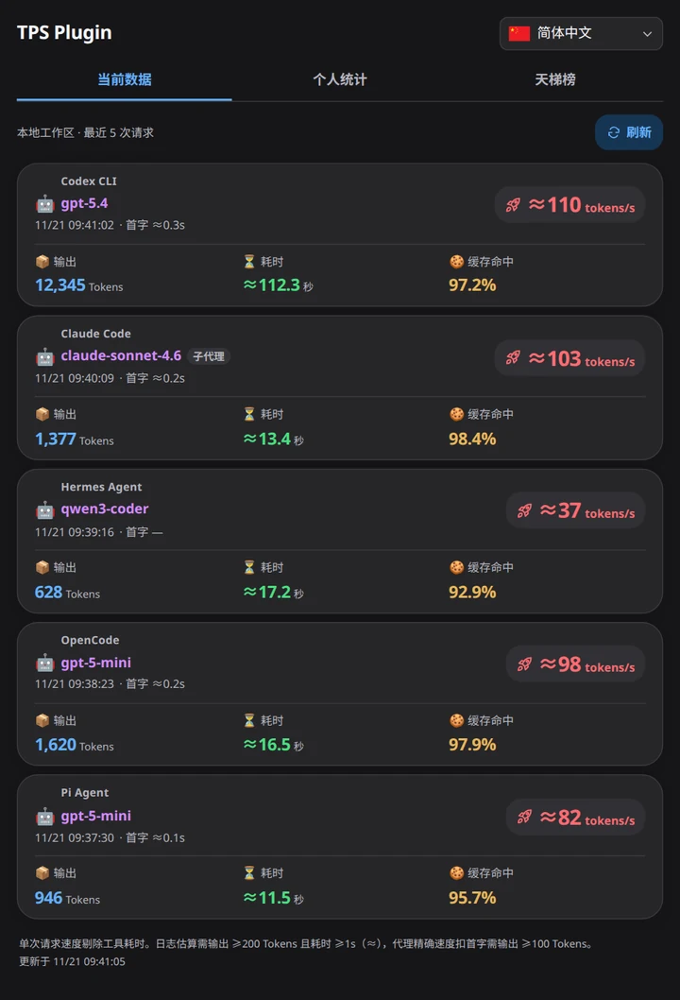
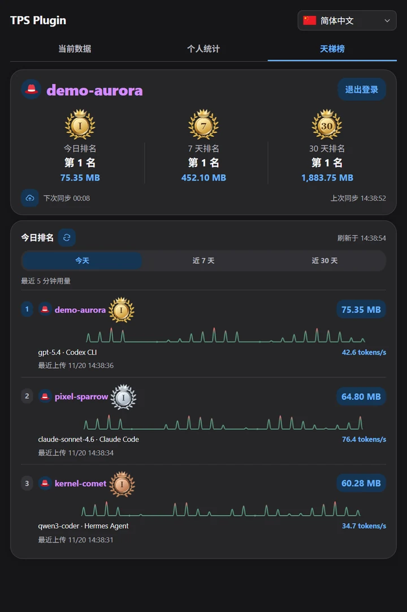

# TPS Plugin

**[English](./README.md)** · **简体中文** · **[Orca 插件目录](https://api.onorca.dev/plugins/jecyxyf/orca-tps-plugin)**

## 1. 项目描述

TPS Plugin 在 Orca 右侧栏显示 AI 请求的 Token 用量和生成速度。你可以查看当前会话、回顾个人用量，也可以用 GitHub 账号参加天梯榜。

插件支持本机和远程工作区，提供 15 种界面语言，并记住上次选择。

## 2. 界面预览

在 Orca 右侧栏打开 **TPS Plugin**，即可切换**当前数据**、**个人统计**和**天梯榜**。

  

*截图使用示例数据。*

## 3. 功能描述

### 3.1 当前数据

- 跟随当前 Orca 频道，最多显示最近 100 次请求。
- 查看模型、输出量（Tokens）、生成速度（tokens/s）、请求耗时和缓存命中率。有记录时也会显示首字延迟。
- Orca 底部状态栏显示最新速度和缓存命中率。估算速度带有 ≈ 标记。

  

### 3.2 个人统计

- 查看今日、近 7 天、近 30 天、今年或过去 365 天的用量与请求数。今日还会显示单次请求的最大生成速度。
- 按工具和模型查看用量，比较各模型的平均生成速度。用量以百万 Token（M）计，包含新输入、输出和缓存读写。
- 无需登录即可合并本机和 SSH 主机的用量。热力图显示过去 365 天，可在 Orca 的 TPS Plugin 设置中调整统计时区。

  

### 3.3 天梯榜

- 按天或按小时查看 Token 用量排名和用量趋势。
- 比较各账号的最佳平均生成速度，查看上榜时使用的模型和 Harness。
- 开启天梯排名后，榜单会自动更新。登录 GitHub 即可参榜，同一账号的多台设备合并统计。

  

## 4. 支持的 Harness

  

## 5. 原理描述

  

- 本机和远程设备各自采集并保存 Token 用量。
- Tokens 管家通过 SSH 同步用量，个人统计和天梯榜上报共用一份汇总。
- 天梯榜服务器在内存里计算排名，用量和速度数据只保存在内存中。 [服务端说明](./server/README.md)
- 天梯榜服务器无需数据库。原始会话日志留在设备上，GitHub 账号和登录状态保存在服务器文件中。

## 6. 安装指南

> [!IMPORTANT]
> **从 1.6.4 升级到 1.6.5**
>
> 1.6.5 大幅调整了插件结构，天梯榜服务器也已迁移。请先在 Orca 中卸载旧版 TPS Plugin，再安装 **1.6.5**。

- **环境要求**　Windows 或 Linux 上使用 Orca 1.4.251 或更新版本。采集 SSH 工作区用量时，远程主机需安装支持 SQLite 的 Node.js 22.13 或更新版本。
- **插件目录安装**　在 **Orca → 设置 → 插件** 中搜索 **TPS**，选择 **jecyxyf** 发布的插件，安装并确认权限。[查看插件条目](https://api.onorca.dev/plugins/jecyxyf/orca-tps-plugin)
- **本地安装**　克隆本仓库，在 **设置 → 插件 → 开发目录** 中添加包含 `orca-plugin.json` 的目录，然后启用插件。
- **打开插件**　在 Orca 右侧栏打开 **TPS Plugin**。

## 7. 已知问题

设备上报榜单后，若在同步前关机，其他设备的个人统计会暂时落后。设备重新上线并同步后会补齐。后续沿用现有同步方式。

## 8. 下个版本的优化计划

大幅优化插件界面的视觉设计和布局，让插件更现代、更有趣。

[MIT 许可](./LICENSE) · [第三方许可声明](./THIRD_PARTY_NOTICES.md)
