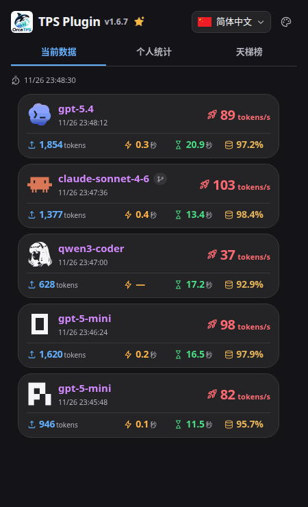
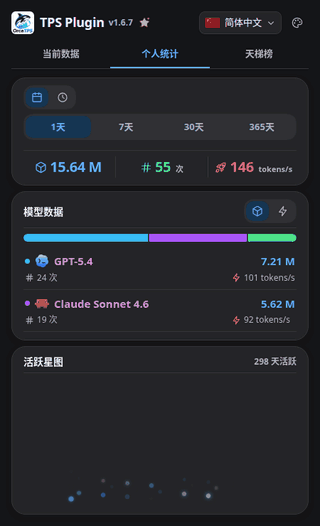
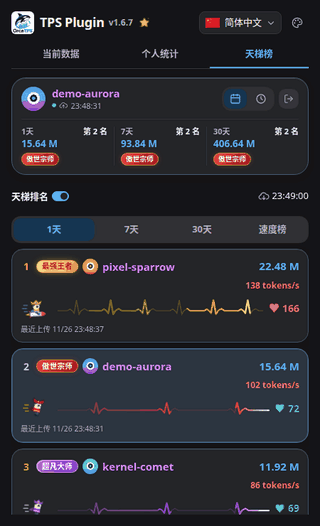
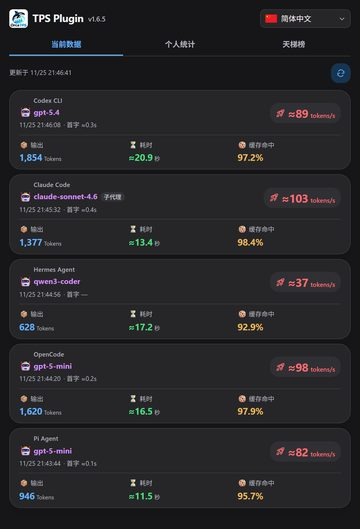
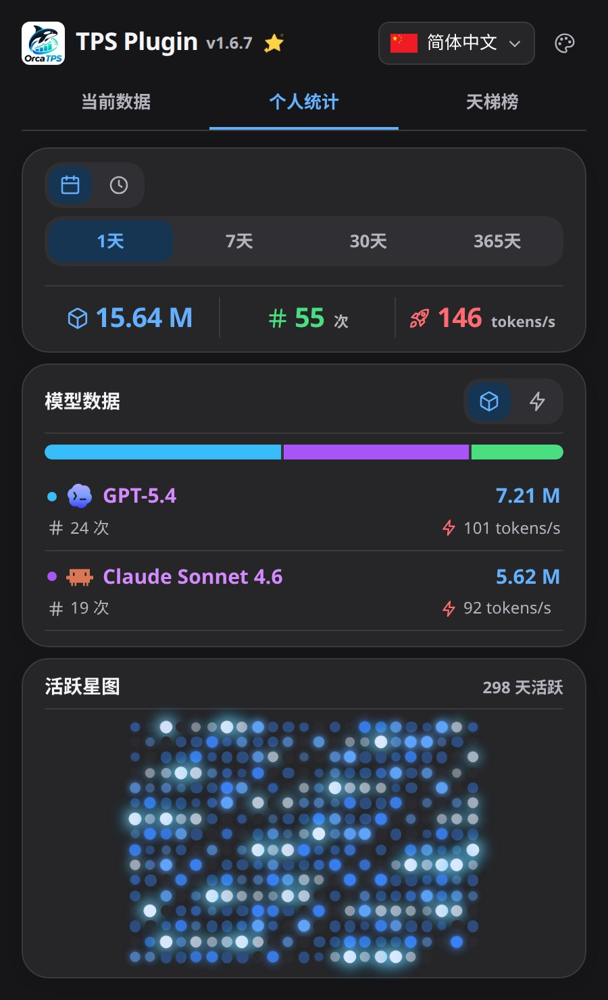
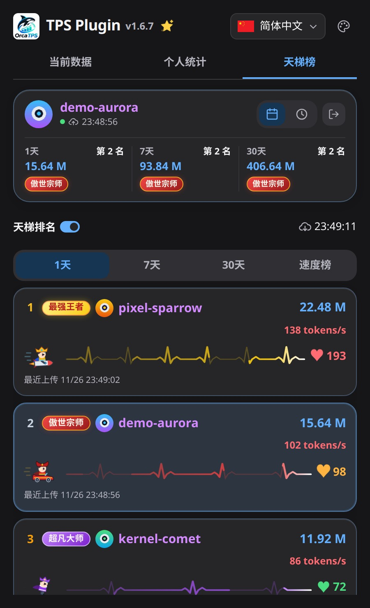
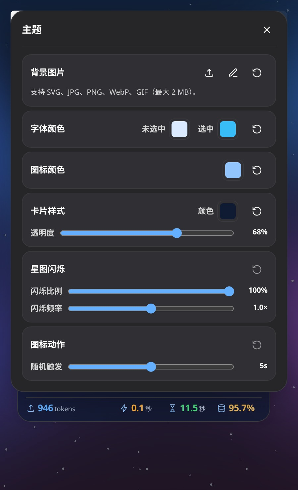
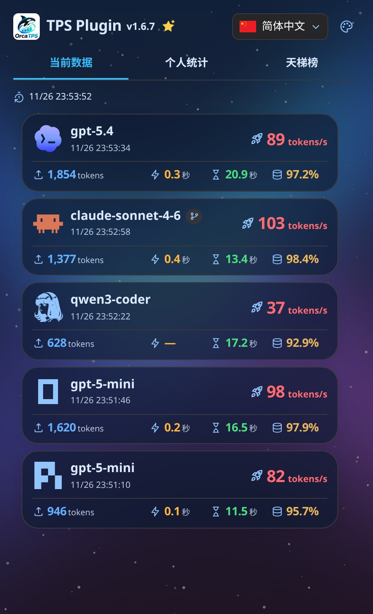
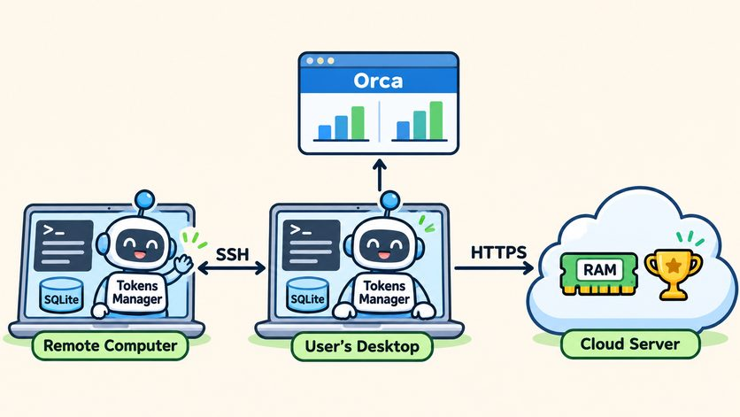

# TPS Plugin

**[English](./README.md)** · **简体中文** · **[Orca 插件目录](https://api.onorca.dev/plugins/jecyxyf/orca-tps-plugin)**

> [!NOTE]
> **写在前面**
>
> 娱乐插件，屎山代码，能用就行。
>
> - **后台采集**：为了汇总所有设备的 Token 用量、减轻服务器负担，各设备会在后台运行 Token 采集管家脚本，介意的请勿使用。
> - **纯内存运行**：服务端没有数据库，全程纯内存运行，不记录任何用户信息。
> - **目录收录**：当前版本不知什么原因，一直未能被官方插件目录收录。
> - **开发计划**：后续只做维护修复；在到达 **1,000 Star** 之前，不再开发新功能。
>
> 希望这个插件可以给您的编程旅途带来快乐。

## 1. 项目描述

TPS Plugin 在 Orca 右侧栏显示 AI 请求的 Token 用量和生成速度。你可以查看当前会话、通过交互图表与 365 天活跃星图回顾个人用量、自由定制面板主题，也可以用 GitHub 账号参加天梯榜。

插件支持本机和远程工作区，提供 17 种界面语言，并记住上次选择。

## 2. 界面预览

在 Orca 右侧栏打开 **TPS Plugin**，即可切换**当前数据**、**个人统计**和**天梯榜**。

<table>
  <tr>
    <td width="33%" align="center">
       
      <b>当前数据</b>
    </td>
    <td width="33%" align="center">
       
      <b>个人统计</b>
    </td>
    <td width="33%" align="center">
       
      <b>天梯榜</b>
    </td>
  </tr>
</table>

*预览使用示例数据。*

## 3. 功能描述

### 3.1 当前数据

- 跟随当前 Orca 频道，最多显示最近 100 次请求，并展示对应 Harness 图标、子代理/代理标识与更新时间。
- 查看模型、输出量（Tokens）、生成速度（tokens/s）、请求耗时、首字延迟（有记录时）和缓存命中率。
- 收到新请求时触发极光边框流光与彩虹星尘粒子动画，可见卡片的 Harness 图标还会随机做出小动作。
- Orca 底部状态栏实时显示最新速度和缓存命中率（估算速度带 `≈` 标记），标题栏支持一键跳转并 Star 仓库。

  

### 3.2 个人统计

- 顶部图标胶囊一键切换**按天数**或**按小时**统计，支持查看 **1天**、**7天**、**30天** 与 **365天** 数据。
- 汇总显示总用量（含缓存读写）、请求数和今日最大单次速度；新数据到来时触发数字滚动增长、行闪光和 `+Δ` 增量提示。
- **模型数据**顶部配备彩色分段占比条，支持按**用量**或**均速**排序切换，对齐显示各模型图标、用量、请求数与平均速度。
- 365 天**活跃星图**支持下落唤醒入场动画与星点闪烁效果；无需登录即可自动合并本机与 SSH 主机用量。

  

### 3.3 天梯榜

- 将个人账号状态、上传时间与 **1天 / 7天 / 30天** 排名合并在同一概览卡片，搭配 7 级皇室段位徽章（最强王者、傲世宗师、超凡大师、璀璨钻石、华贵翡翠、流光铂金、荣耀黄金）。
- **1天**榜根据近 5 分钟上传活跃度计算心跳 BPM，展示坐在火箭上、坐在跑车上、狂奔、喘息、躺平等皇室角色姿态与按段位上色的实时心电图（ECG）动画。
- **7天**榜展示按段位上色的流光曲线与脉动节点；**30天**榜展示按段位上色的点阵均衡器跳动动画。
- **速度榜**对比各账号最佳平均生成速度，前三名带 `S` 级标识，并展示模型名称、Harness 图标与对应 Token 数。

  

### 3.4 主题设置

点击右上角调色盘按钮即可打开**主题**设置弹窗，面板背景保持清晰可见，方便实时预览每一项调整：

- **背景图片**：支持上传 SVG、JPG、PNG、WebP、GIF 图片（最大 2 MB），内置全屏编辑器支持拖动平移、滚轮/按钮缩放与位置复位。
- **字体与图标颜色**：独立自定义未选中文字、选中高亮色和图标颜色，支持一键恢复默认。
- **卡片样式**：自定义卡片背景颜色与透明度（`0%`–`100%`），搭配自定义背景图呈现磨砂玻璃质感。
- **星图闪烁**：自由调节活跃星图的闪烁比例（`0%`–`100%`）与闪烁频率（`0×`–`2.0×`）。
- **图标动作**：调节当前数据页 Harness 图标随机触发小动作的时间间隔（`0s`–`10s`，可关闭）。

<table>
  <tr>
    <td width="50%" align="center">
       
      <b>主题设置弹窗</b>
    </td>
    <td width="50%" align="center">
       
      <b>自定义背景与半透明卡片效果</b>
    </td>
  </tr>
</table>

## 4. 支持的 Harness

  

## 5. 原理描述

  

- 本机和远程设备各自采集并保存 Token 用量。
- Tokens 管家通过 SSH 同步用量，个人统计和天梯榜上报共用一份汇总。
- 天梯榜服务器在内存里计算排名，用量和速度数据只保存在内存中。 [服务端说明](./server/README.md)
- 天梯榜服务器无需数据库。原始会话日志留在设备上，GitHub 账号和登录状态保存在服务器文件中。

## 6. 安装指南

> [!IMPORTANT]
> **从 1.6.4 升级**
>
> 1.6.5 及之后版本大幅调整了插件结构，天梯榜服务器也已迁移。请先在 Orca 中卸载旧版 TPS Plugin，再安装 **1.6.7**。

- **环境要求**　Windows 或 Linux 上使用 Orca 1.4.251 或更新版本。采集 SSH 工作区用量时，远程主机需安装支持 SQLite 的 Node.js 22.15 或更新版本。
- **插件目录安装**　在 **Orca → 设置 → 插件** 中搜索 **TPS**，选择 **jecyxyf** 发布的插件，安装并确认权限。[查看插件条目](https://api.onorca.dev/plugins/jecyxyf/orca-tps-plugin)
- **本地安装**　克隆本仓库，在 **设置 → 插件 → 开发目录** 中添加包含 `orca-plugin.json` 的目录，然后启用插件。
- **打开插件**　在 Orca 右侧栏打开 **TPS Plugin**。

[MIT 许可](./LICENSE) · [第三方许可声明](./THIRD_PARTY_NOTICES.md)
